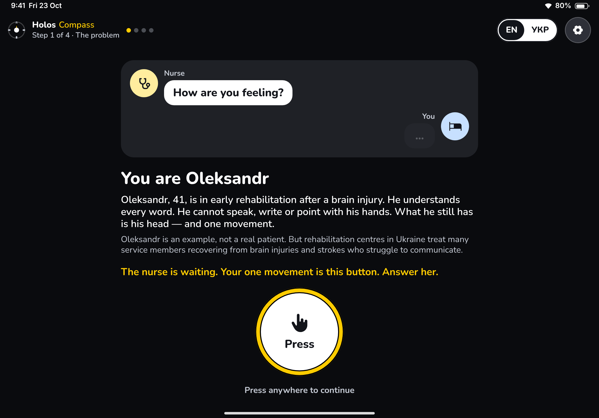
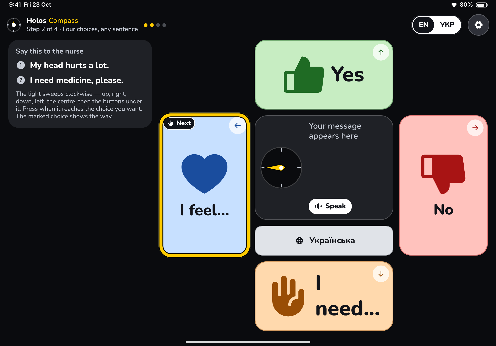
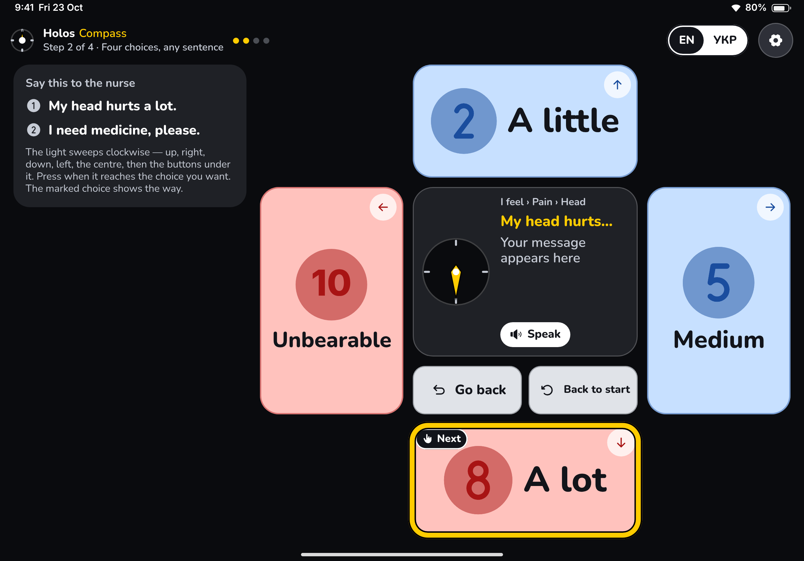
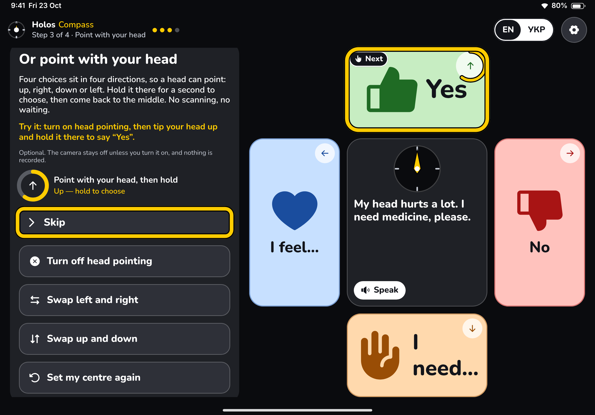
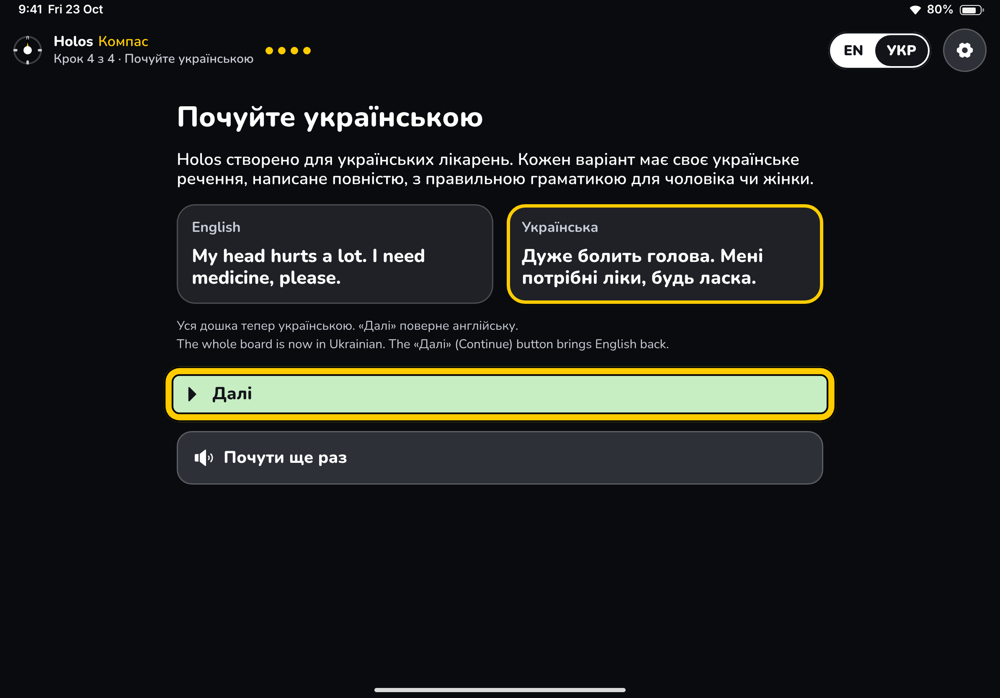
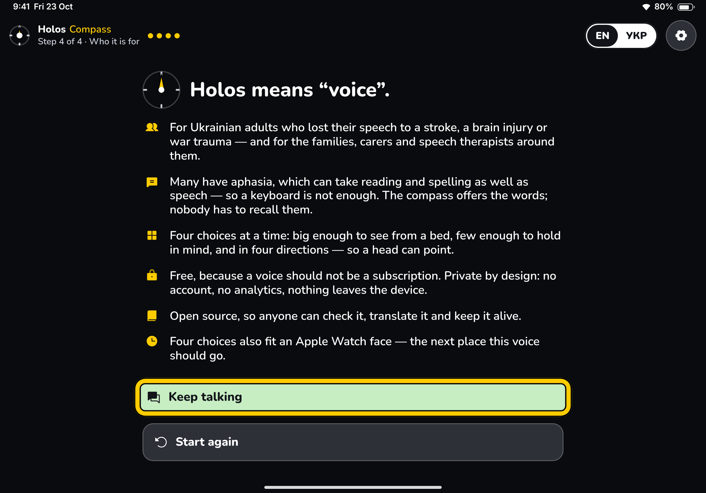
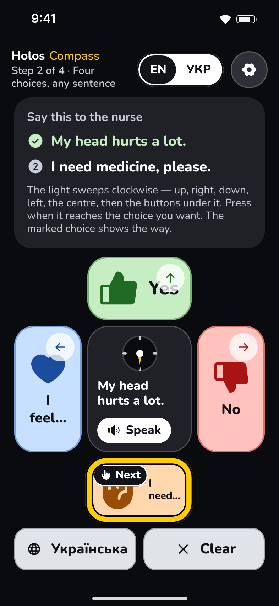

# Holos Compass — "Four choices, any body"

## The idea in one line

Every screen offers at most four huge choices at north, east, south and west around a centre hub. Each choice goes one level deeper, and the path builds the sentence ("I feel… → Pain… → Head → A lot" says "My head hurts a lot."). Because there are only four directions, a head can **point** at a choice instead of waiting for a scan.

## Who it serves best

- **Oleksandr** (head movement only) gains the most. With head pointing he tips or turns his head up, right, down or left and holds for a second, with no scan to wait through. Below the first level, resting his head in the middle for about seven seconds steps back one level, so he is never stuck deep in the tree. His "one other movement", if he has one (a tap, a key or a controller button), becomes Back, or Speak at home.
- **Mykola** (stroke, reads simple words, left-hand switch) is served well. There are only four targets, each the size of a hand, with picture and word on every one, and the scan ring is always the same shape: four petals, the centre, then the chip(s) under it.
- **Bedside and low-vision use** in general: the dark background puts all the contrast on four pale petals that can be read from a pillow.
- **Yuriy** (can read, can't find words) is served adequately. The tree offers words instead of asking him to recall them, but only a few at a time. A large vocabulary means a deeper tree.
- **Serves worst:** anyone who needs a broad vocabulary quickly, or wants to combine words freely. Compass speaks finished sentences from a curated tree, so it can't build "my left hand is cold". A speech therapist will see it as a strong *first* board, not the only one.

## What to try first (60-second tour for Anna)

1. On the first screen, press Space (or tap anywhere) once and watch "nothing" happen. Press again.
2. In step 2, follow the "Next" tag: wait for the light to reach **I feel…** (the left petal) and press. Then press on **Pain…**, **Head** and **A lot**. Watch the yellow draft in the hub ("My head hurts…"), and hear the sentence the moment you finish it.
3. Wander off on purpose: open **I need… → More…** and see the "Next" tag move to **Go back**. Two levels down, **Back to start** appears beside it. Nothing is ever wrong.
4. In step 3, choose **Turn on head pointing**, hold still for a moment, then tip your head up and hold. The ring fills on the Yes petal and "Yes." is spoken.
5. On the free board, press when the light reaches the **Українська** chip under the hub. Every label and the voice switch to Ukrainian. With a message built, press on **Clear**: the light opens on **No, keep it** first.

## The 3-minute judged flow

Default scan speed is 1.4 s per step. The first stop of every new ring stays lit 2.1 s. A full ring at home is 6–7 stops, about 9 s.

| Step | What happens | Presses | Est. seconds | Running total |
|---|---|---|---|---|
| 1. The problem | Nurse bubble "How are you feeling?". One big button. Presses count after a 2 s read gate. The first press gives a dull "nothing" and an empty reply bubble, and the page scrolls the payoff into view. The second press continues. Copy is about Oleksandr: "his head — and one movement". | 2 | ~28–30 | 0:28–0:30 |
| 2. Four choices, any sentence | Goal: "My head hurts a lot. I need medicine, please." **Sentence 1:** W lit at 4.9 s → Pain (N, first) → Head (N, first) → A lot (S, lit at 3.5 s), about 12 s. **Sentence 2:** S at home (3.5 s), then Medicine (E, 2.1 s), about 7 s. Each sentence speaks as soon as it is finished. Then the "You said it" card and Continue (1.5 s read gate). Reading the goal included. One missed sweep (likely while reading) adds about 9 s. | 7 | ~35–45, +~9 for one missed sweep | ~1:03–1:24 |
| 3. Point with your head (optional) | Presses count after a 1.2 s read gate. Skip is lit first, and this panel never rests while pointing is off, so skipping costs one press. Trying it: Turn on head pointing (2nd stop), camera prompt, hold still about 1 s, tip the head up and hold 1 s, success, then the step moves on by itself after 3 s. | 1 (skip) / 1 + head (try) | ~14 (skip) / ~35 (try) | ~1:17–1:38 (skip) |
| 4. Hear it in Ukrainian | "Hear it in Ukrainian" is lit first. The whole board switches to Ukrainian and speaks the step-2 message; the card being spoken is ringed in yellow. VoiceNotice appears (plus an English line) if no Ukrainian voice is installed. Continue is lit next, after a fresh 1.5 s gate, and switches English back; a line in both languages says so. | 2 | ~18–22 | ~1:35–2:00 |
| Closing | Who it is for, aphasia (why a keyboard is not enough), why four choices, free and private (and why free), open source, the Apple Watch roadmap. Keep talking (lit first) or Start again. Never rests. | 1 | ~28–32 | **~2:03–2:32** |

On the skip path that leaves about 28–57 s of slack under 3:00 for hesitation. Trying head pointing adds about 21 s (~2:24–2:53), so slack falls to about 7–36 s. If timing tests run long, cut step 3 to a Skip-only explanation. The arc stays: problem → voice → aphasia → Ukrainian. Step 3's head pointing stands in for the brief's aphasia board, and aphasia itself is carried by the closing (see Risks).

The only screens that can still rest (and need a press to wake) are the boards, after three quiet loops at home (about 30 s), and step 3's panel while pointing is on. Both say "Resting. Press to start again."

## Screens

Design mockups of this flow, redrawn from the code — not device screenshots, since nothing has been
built yet. The [gallery](../design/README.md#holos-compass) captions each one, and
[FINDINGS.md](../design/FINDINGS.md#holos-compass) lists the layout problems the redraw turned up.

## How one switch drives every screen

- Every input (tap anywhere, Space/Enter, any controller button, head turn) arrives through Core's `SwitchHub`. Each screen calls `hub.route` when it appears, so the newest screen always owns the switch.
- **Narrative screens** (problem, head, Ukrainian, closing): a press is "continue" or picks the lit button, after a 1.2–2 s read gate so a double press can't skip a screen. The Ukrainian step closes its gate again for 1.5 s after "Hear it", so a bounced press can't leave before the Ukrainian starts. The two-button screens never rest. The step coordinator's `advance(from:)` only moves on if that step is still current, so a timer and a press racing each other can't skip a step.
- **Pages taller than the screen.** In scanning mode the whole screen is the switch, so nobody can scroll by finger. Each page brings what matters into view itself: the problem page scrolls to its payoff after the first press, step 3 scrolls to the lit button, the Ukrainian page and the closing keep their buttons in view. The closing is laid out to fit where it can (buttons beside the text on a wide iPad) and only scrolls on a phone. In step 2 the goal card keeps at most about 40% of a phone's height and brings "Move on" into view when it appears.
- **Boards** scan each level as one flat ring in a fixed clockwise order: **N → E → S → W → centre (Speak) → the chip(s) under it**. The fifth stop is always Speak; the sixth is Back below home and the language at home (plus Clear once there is a message). Two or more levels down, **Back to start** follows Back, so getting home never costs a full ring per level; it keeps the message, so it asks for nothing more. Language is chosen before a sentence, never in the middle of one, so it lives at home. Clear, scanned, is a group that opens on **No, keep it**; only **Yes, clear all**, lit one step later, clears. A double press therefore keeps the message, as in Core's message bar. (Compass turns off the scanner's back cells: Clear is its only group, and No is already the way out. Two quiet loops still leave the group.) On a phone the chips sit in a full-width row under the cross, so their titles never shrink to "…".
- **Head pointing** stops the scan. The head lights the petal it points at (dominant axis beyond `headTurnDegrees`), and a 1-second hold chooses it. The head has to come back to the middle before the next choice. Below home, resting in the middle for five scan steps (about 7 s) steps back one level, with a ring filling on the Back chip; any pointing restarts the count, it waits while the voice is speaking, and it never happens at home. `.head` presses from Core's head switch are ignored in this mode. Pointing honours Settings' hold like every other switch: while the sheet is open nothing lights or is chosen, and the head must return to the middle afterwards. If the camera is refused, absent, calibrating or can't see a face, the status says so and the scan takes over automatically.
- **Touch / VoiceOver / Switch Control:** the scanner stops, the tap area turns off and every petal, chip and button is a real, labelled button with its own haptic and sound. VoiceOver reads the ring in scan order (sort priorities), not layout order.
- **Auditory prompts** speak each stop in the board's own language. The language stop says "Switch to Ukrainian" (or «Перейти на англійську»), never «Українська» through an English voice.

## What makes it different

- **The head can point, not just press.** No other prototype lets the head choose directly. This prototype builds its own `HeadPointer` on top of Core's calibrated yaw and pitch instead of using the shared head-switch panel.
- **The path is the sentence.** The hub shows the trail ("I feel › Pain › Head"), the yellow draft ("My head hurts…") and the white message underneath. In Ukrainian the upper drafts are headings («Як я почуваюся:», «Де болить:»), because a half sentence would not agree with every choice below it.
- **Every finished sentence is written out whole in both languages.** Nothing is concatenated: «Мені потрібна вода» vs «Мені потрібні ліки»; «Я втомився» / «Я втомилася» via `ukFeminine`. Pain levels use the 0–10 numbers ward staff already ask about, and the top level says "unbearable" in the label and both languages.
- **The needle.** A dial in the hub swings clockwise with the scan and follows the head when pointing. Under Reduce Motion it jumps instead of swinging. The needle shows where the light is without any words.
- **Four choices fit an Apple Watch face.** That is the most direct path to the roadmap's wrist companion.

## Strengths

- Minimal memory load: never more than four ideas on screen.
- Huge targets: on an iPad in landscape, each petal is roughly 300×250 pt.
- Short paths. Yes/No take one press from home, and every sentence is at most four choices deep. The judged goal takes six choosing presses.
- A predictable ring. The fifth stop is always Speak; the sixth is Back below home and the language at home (plus Clear once there is a message). It can be learnt by feel and sound.
- Speaking happens at the moment of choice, so nothing extra is needed to be heard. The centre repeats the whole message for the next person who walks in.
- Can't be failed: the "Next" tag follows the person and moves to Back if they wander. Any three sentences, or speaking the message, also finish step 2, and "Move on" appears after 45 quiet seconds. A judge who moves on without saying anything is told so honestly ("Moving on."), not "You said it".

## Risks and open questions

- **Vocabulary breadth.** A four-way tree is deep for anything outside the core needs. The real app needs a therapist-designed tree and probably a "favourites" level. This is the biggest open question for the concept.
- **The aphasia beat moved.** The brief's step 3 is an aphasia board that offers words a person can't recall. Compass replaces it with head pointing, and carries aphasia in the closing instead ("Many have aphasia… The compass offers the words; nobody has to recall them."). A judge sees the offering of words throughout step 2, but the word "aphasia" only appears at the end.
- **Pitch sign and mirroring are unverified.** The default mapping (yaw > 0 = right, pitch > 0 = up) is a guess, which is why the panel has "Swap left and right" and "Swap up and down". It needs testing on a real iPad and a Mac. Pitch range from a pillow may be smaller than yaw; the same threshold is used for both.
- **Core's head switch still "presses" on left and right turns** at 0.4 s, before the pointer's 1-second hold completes. Those presses are ignored, but the edge flash still blinks, which could read as a premature choice. A Core option to silence the yaw trigger while pointing would fix it.
- **Resting to go back** takes about 7 s at the default speed. Too short, and someone with aphasia reading four choices is bounced back mid-thought; too long, and a wrong turn is slow to undo. It needs testing with real users. Speak still needs the person's one other movement (or finishing a sentence, which returns home).
- **Pages in scanning mode can't be scrolled by finger**, so the code scrolls the lit control (or the line that matters) into view, and the closing is laid out to fit on iPad. On a phone the closing and the Ukrainian page scroll to their buttons once presses count, so their first lines show only briefly; at the largest text sizes step 2's how-to line is dropped so the goal stays visible.
- **Two SF Symbols outside the vetted list:** `arrow.left.arrow.right` and `arrow.up.arrow.down` (both SF Symbols 1.0, used only on the swap buttons).
- No compiler was available. The code was written against Core's exact API and re-read for Swift 6 concurrency, but it hasn't been built.

## How it would grow into the real app

1. A therapist-reviewed tree (pain, body, needs, feelings, people, everyday phrases) as data, editable by a carer. `CompassTree` is already plain data with a route finder.
2. ARASAAC pictograms instead of SF Symbols.
3. A personal top level ("My four"), with family names and photo cells.
4. Calibrated head pointing with per-person thresholds and rest times, persisted pointing preferences, and a "rest" gesture that pauses pointing.
5. **Apple Watch:** the same four-choice tree on the watch face, using the Digital Crown or a double-tap as the switch.
6. Export the tree in an open board format so other AAC apps can use it.

## Files

- `App/HolosCompassApp.swift`: `@main`. Creates `HolosServices("holos.compass")`, starts the hub and feedback.
- `App/RootView.swift`: top bar plus the current step (cross-fade), Settings sheet, `switchKeys`/`switchPressFlash`, dark scheme.
- `App/Experience.swift`: `FlowStep` and the `Experience` coordinator (`advance(from:)`, restart, keep talking), which owns the shared `HeadPointer`.
- `App/TopBar.swift`: name, "Step n of 4", progress dots, `LanguageToggle`, Settings button. Has a compact variant for phones.
- `Copy.swift`: every prototype UI string as `Bilingual`, grouped by step.
- `Vocabulary/CompassTree.swift`: `Direction`, `CompassAction`, `CompassChoice`, `CompassLevel`, `CompassTree` (with route finding for the guide).
- `Vocabulary/Vocabulary.swift`: the whole tree, with every leaf sentence written out in English and Ukrainian.
- `Board/CompassController.swift`: navigation (Back, Back to start, rest-to-back), scan ring with the cancel-first Clear group, press handling (scan, touch, pointing), message keeping, auditory labels.
- `Board/HeadPointer.swift`: turns head yaw/pitch into a pointed direction, with a 1 s hold, re-arming, swap toggles, rest-to-go-back and Settings' hold.
- `Board/CompassDial.swift`: the cross layout of four petals, hub and chips (in the centre, or in a row below on a phone), with sizing metrics.
- `Board/PetalView.swift`: one petal, with symbol, word, direction arrow and hold ring.
- `Board/HubView.swift`: the centre, with needle, trail, draft and message. It is also the Speak stop.
- `Board/HubChip.swift`: the chips under the centre (Back with its rest ring, Back to start, language, Clear, No keep it / Yes clear all).
- `Board/NeedleDial.swift`: the compass needle that follows the light.
- `Board/GuideMarker.swift`: the small "Next" tag.
- `Board/PointingStatus.swift`: live head-pointing status, hold ring and the "rest to go back" hint.
- `Board/StopButton.swift`: the large scannable button used on narrative steps.
- `Board/ScrollReveal.swift`: `ScrollViewProxy.reveal`, which brings a lit control into view (a jump under Reduce Motion), because scan-mode pages can't be scrolled by finger.
- `Board/CompassTheme.swift`: dark palette, keylines and fonts.
- `Steps/ProblemStep.swift`: step 1.
- `Steps/ComposeStep.swift`: step 2 (guided board, bounded goal card, Move on, done card).
- `Steps/HeadPointStep.swift`: step 3 (read gate, pointing panel that follows the lit button, live compass).
- `Steps/UkrainianStep.swift`: step 4 (bilingual cards, hear in Ukrainian, restores English).
- `Steps/ClosingStep.swift`: the closing card (fits or scrolls to its buttons; Keep talking / Start again).
- `Steps/FreeBoardStep.swift`: the free board with carer controls and head pointing.
