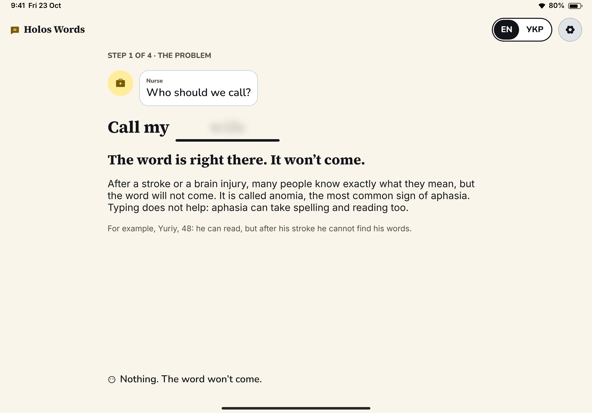
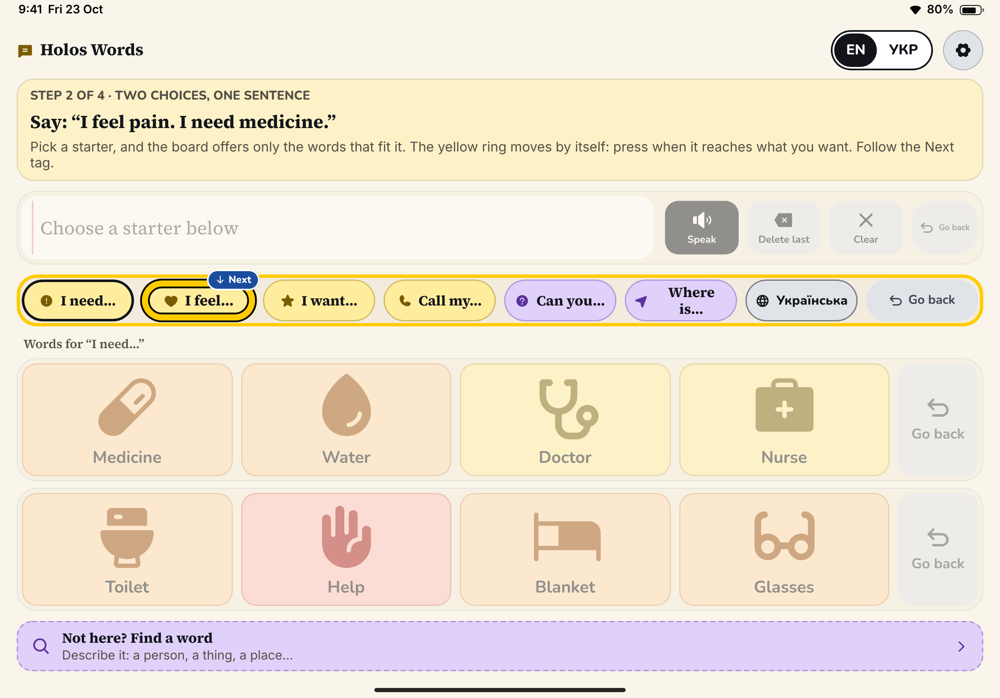
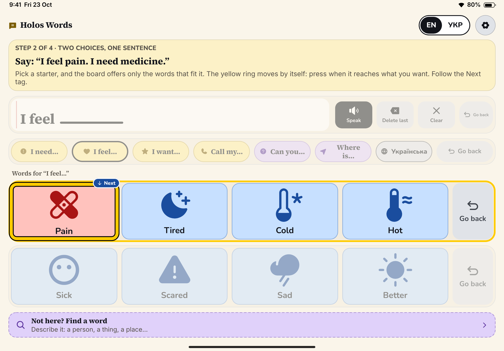
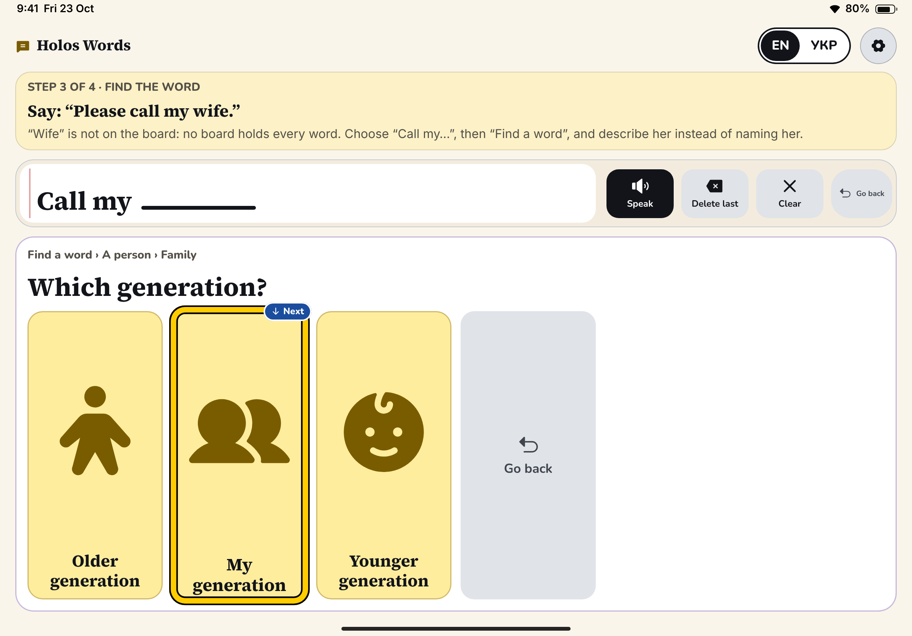
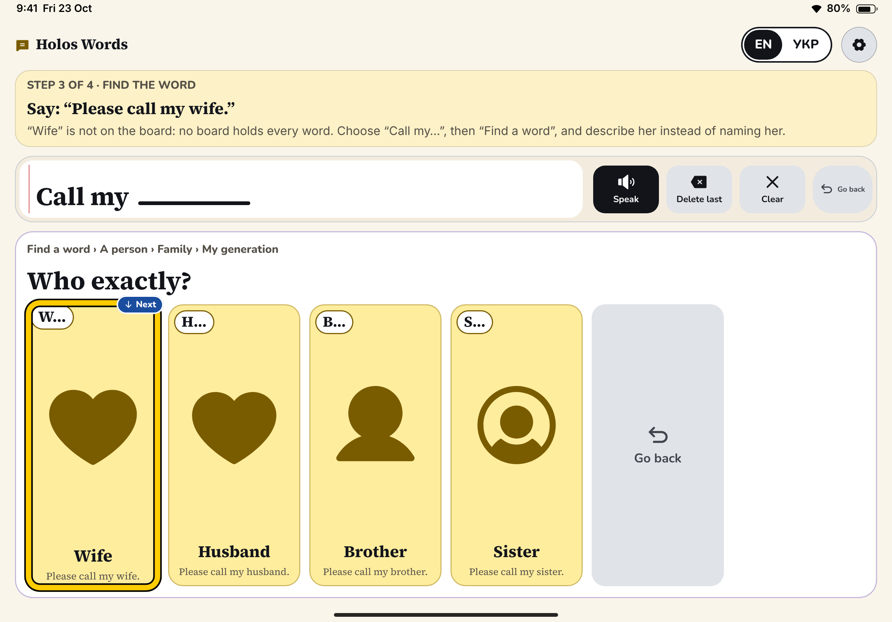
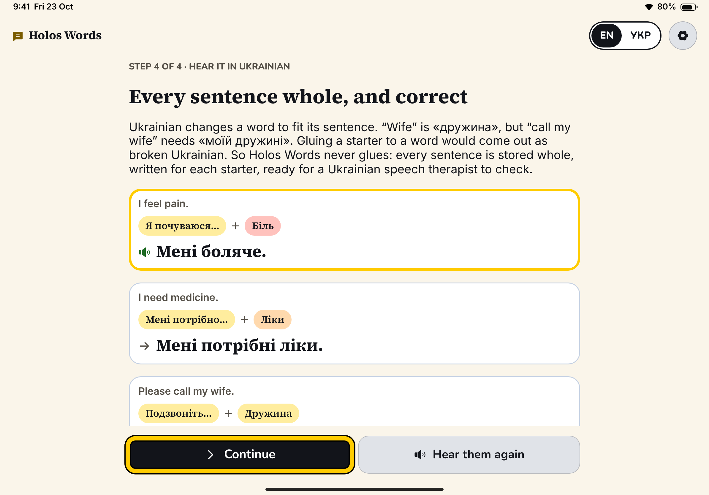
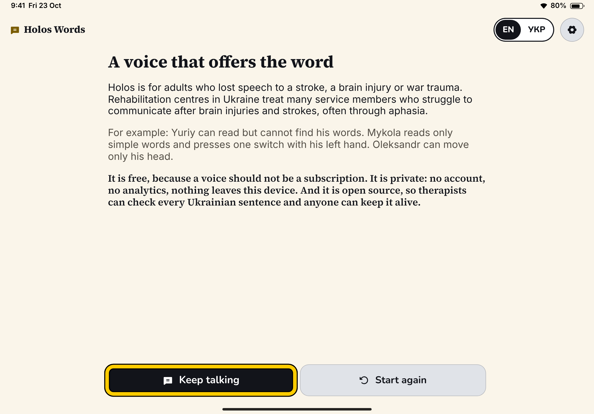
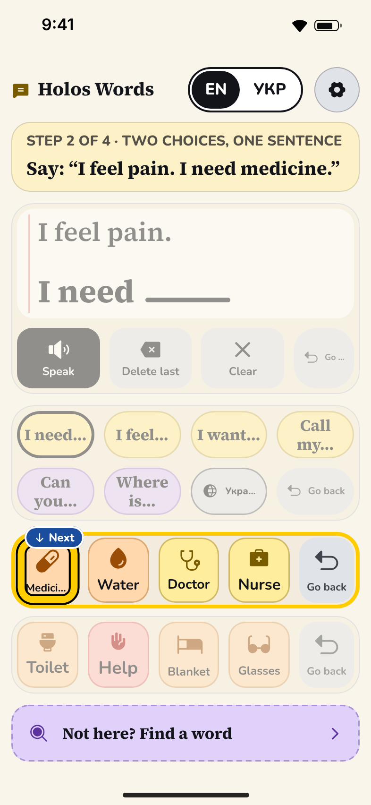

# Holos Words — "Find the word"

## The idea in one line

A board for anomia: pick a sentence starter and the board offers only the words that fit it, so a whole sentence takes two choices. When the word isn't there, you describe it (a person, then family, then my generation) until you can recognise it among a few pictures. You never have to recall it.

## Who it serves best

- **Yuriy (48, aphasia: can read, can't find words).** This prototype is built around him. Anomia is the most common sign of aphasia, and both tools here work by turning recall, which he can't do, into recognition, which he can. The starter carries the grammar. Find a word borrows from semantic feature analysis, an approach speech therapists already use for anomia.
- **Speech therapists.** The vocabulary is adult and hospital-shaped: medicine, a nurse, *commander*, *brother-in-arms*, documents. Every sentence is stored whole in both languages, so a therapist can review it line by line.
- **Family and carers.** They hear complete, polite sentences such as "Please call my wife." instead of telegraphic single words.

**Who it serves worst:**
- **Mykola**, who reads only simple words. The concept depends on reading: starters, a sentence written in serif type, and a candidate's sentence preview. The pictures help, but this is the most text-heavy of the five prototypes.
- **Oleksandr** (head turns only). Find a word adds three or four levels, each a linear scan, so a missing word is slow to reach with a head switch. The fillers themselves are as fast as on any board.
- **People whose aphasia also affects comprehension.** "What kind of thing is it?" is itself a language task.

## What to try first (60 seconds for Anna)

1. Open the playground and press Space through step 1. For the first 5 seconds a press only knocks: that is the point of the scene.
2. In step 2, press once when the yellow ring outlines the starters row, then again when it reaches **I feel…**. The highlight then jumps straight to the feelings. That jump is the concept.
3. In step 3, watch **Call my… → Find a word → A person → Family → My generation → Wife**. Each candidate shows a first-letter cue ("Д…" in Ukrainian) and the sentence it will make.
4. Tap **УКР** in the top bar on the board. The sentence bar rewrites itself: "Please call my wife." becomes «Подзвоніть, будь ласка, моїй дружині.» Then compare the starter chip «Подзвоніть…» and the cell «Дружина» with that sentence. Step 4 makes the same point on purpose.
5. In Settings, switch to "Touch the pictures" and try the free board after the tour.

## The 3-minute judged flow

Default scan speed is 1.4 s per step, and the first item of each new level is lit for 2.1 s. Press counts are switch presses. Times include reading.

| Step | What happens | Presses | Est. seconds | Running total |
| --- | --- | --- | --- | --- |
| 1. The problem | A nurse asks "Who should we call?". "Call my ____" shows *wife* blurred inside the blank. For 5 s every press gets only a dull knock and a shake. Then "Press anywhere, or Space, to begin" lights up. | 1 (plus any tries) | 22 | 0:22 |
| 2. Two choices, one sentence | Goal: "I feel pain. I need medicine." Scan path: starters (2.1) → I need (2.1) → I feel (1.4) ✓ → words row (2.1) → Pain (2.1) ✓ → sentence row (2.1) → starters (1.4) → I need (2.1) ✓ → words row (2.1) → Medicine (2.1) ✓ → sentence row (2.1) → Speak (2.1) ✓. The scan waits total 23.8 s. Then about 2.5 s of speech and about 2 s of "You said: …". | 10 | 36 | 0:58 |
| 3. Find the word | Goal: "Please call my wife." Starters (2.1) → need, feel, want (4.9) → Call my (1.4) ✓ → two word rows (3.5) → Find a word (1.4) ✓ → Person (2.1) ✓ → Family (2.1) ✓ → Older generation (2.1) → My generation (1.4) ✓ → Wife (2.1) ✓ → sentence row (2.1) → Speak (2.1) ✓. The scan waits total 27.3 s. About 3 s goes to reading questions and about 3 s to speech. | 9 | 42 | 1:40 |
| 3b. Head turn (optional) | Core's `HeadTryPanel`. Skip is lit first. | 1 | 9 (about 20 if tried) | 1:49 |
| 4. Hear it in Ukrainian | After a 1 s settle, the person's own sentences play in Ukrainian one after another (about 8 s), while the judge reads about 60 words on why. Each card shows *starter + word* above the real sentence. Continue is lit first and the scan never pauses here, so one press always moves on. Without a Ukrainian voice the step is read, not heard (see Risks). | 1 | 25 (up to 30) | 2:14 |
| Closing | About 110 words: who it is for, and why it is free, private and open source. Keep talking is lit first and the scan never pauses. | 0–1 | 30 | **about 2:44** (about 2:55 with the head turn tried) |

The margin is thin: a judge who also listens through step 4 before reading lands at about 2:49, or about 3:00 with the head turn tried. If testing runs long, cut in this order: the closing personas line (`Copy.closingPeople`, about 7 s), then the help text in the banners, then the persona line in step 1. Never cut the arc.

## Screens

Design mockups of this flow, redrawn from the code — not device screenshots, since nothing has been
built yet. The [gallery](../design/README.md#holos-words) captions each one, and
[FINDINGS.md](../design/FINDINGS.md#holos-words) lists the layout problems the redraw turned up.

## How one switch drives every screen

- **Step 1.** Every press goes to the scene through `hub.route`. Before 5 s a press knocks (`Feedback.unavailable`), the blank shakes (or doesn't, under Reduce Motion) and the screen edge flashes. After 5 s, a press continues. In touch or VoiceOver mode the copy says "Try to answer", a tap on the scene gets the same knock, and a **Begin** button appears after 5 s (announced as "Ready. Choose Begin.").
- **Board (steps 2–3 and free use).** `WordsBoard` owns one `Scanner`, bound with `bind(to:label:onSelect:)` and `listen(to:)`.
  - Row-column scanning covers the sentence row (Speak · Delete · Clear), the starters row (six starters + language), and two word rows. As in Core's message bar, Clear opens on **No, keep it**, so a double or late press keeps the message; only **Yes, clear all**, lit a full step later, clears.
  - Find a word scans linearly: up to five big answers, then Back.
  - **The scan order follows the sentence.** When a blank is open, the scan starts at its words. When a sentence is finished, it starts at the sentence row, where Speak is. When nothing is built yet, it starts at the starters. Rows never move on screen; only the starting point changes.
  - The language switch is a scanned cell, so a switch-only user can reach Ukrainian.
- **Getting unstuck.** The guide tags the next target with a small **Next** tag, which VoiceOver hears as the element's value. While Find a word is open in scanning mode, the tag never points at Speak (it is not in the scan then) but at Back. Any spoken message completes a step. After 45 s without progress, **Show me** and **Skip this step** join the scan *first*, so one press rescues anyone. Show me does the next step for you. On a phone, the two buttons take the goal text's place, so the board keeps its height. The stall timer runs only while the board is on screen, so "Stuck?" is never announced over another screen.
- **Head turn.** Core's panel owns routing while it is shown. When it finishes, the tour moves on, and the next screen routes presses to its own scanner as it appears.
- **Steps 4 and closing.** Each has a two-item linear scan (Continue / Hear again; Keep talking / Start again). It starts after a 1–1.2 s settle, so a press meant for the previous screen can't choose here, and it never pauses (`loopsBeforePause = .max`), so however long the judge reads, the next press acts rather than only waking the scan. Without a Ukrainian voice, step 4 has Continue alone, drawn lit, and a press is Continue, as on step 1.
- Settings sits outside the switch area on every screen. Core's sheet holds presses while it is open, and the tour does not advance underneath it.

## What makes it different

- **Two choices per sentence.** A starter plus a fitting word gives a whole sentence. The other prototypes offer words; this one offers *sentences that fit the gap you already chose*.
- **A visible blank.** "Call my ____" is drawn as a real gap in a real sentence. The person always sees what the missing word has to do.
- **Find a word = describe, then recognise.**
  - What is it → what kind → 2–4 pictures.
  - Each candidate carries a first-letter cue and the exact sentence it will say.
  - A found word lands in the open starter when that starter can take it ("Call my…" + wife). If it can't, the word goes to its own home starter: with "I feel…" open, a found *wife* becomes "Please call my wife." (With "Where is…" open she becomes "Where is my wife?", because that starter can take her.)
  - A found word is never refused.
- **Ukrainian is handled honestly (the key insight for the real app).** Frames and slots can't be built by concatenation in Ukrainian:
  - "Call my wife" = «Подзвоніть, будь ласка, моїй **дружині**». The noun takes the dative, and "my" has to agree with it («моїй дружині», «моєму братові»), so the starter can’t contain it.
  - "I need" = «Мені потрібен **лікар**», «потрібна **вода**», «потрібні **ліки**». The adjective agrees with a noun it hasn't met yet.
  - "I feel" + "pain" = «**Мені боляче**». The construction is a completely different one.
  - English *call* is two verbs: family are phoned (**подзвонити**), staff are fetched (**покликати**: «Покличте, будь ласка, лікаря»).
  - "I want tea" = «Я хочу **чаю**» (partitive genitive).
  - "I feel tired" = «Я втомився / втомилася» (follows the speaker-gender setting).

  So every filler, under every starter, stores the complete sentence in both languages (`SentenceFrame.fillers` / `.more`, ids `frame.concept`). Find a word maps a concept to the right frame's sentence by id. Step 4 shows this to the judge, and the vocabulary is shaped for review by a Ukrainian speech therapist. **This review is required before submission.**

## Strengths

- It is the most clearly *adult* and most aphasia-specific of the five concepts, and it borrows from therapy practice (sentence frames, the questions of semantic feature analysis, first-letter cues).
- It makes the Ukrainian argument concrete in the judge's own sentences, without a lecture.
- It is fast for the common case. Two scanned choices plus Speak cover the common bedside requests in this vocabulary. The adaptive scan start saves roughly one row's wait per choice.
- It can't get stuck. Wrong turns are re-routed rather than punished, any spoken message moves the tour on, and Show me / Skip appear on their own.
- The calm notebook look (warm paper, ink, red margin line, serif sentence) sets it apart, and the Fitzgerald colours are kept.

## Risks and open questions

- **Adaptive scan start.** Switch users trained on fixed top-to-bottom scanning may find the jumping start point surprising. It probably belongs behind a setting ("Start the scan where the sentence needs you"), and therapists should decide the default.
- **The vocabulary needs a Ukrainian speech therapist's review.** Points to check:
  - «Мені потрібно в туалет» vs «Мені треба в туалет».
  - The chip «Будь ласка…» used for *Can you…*.
  - «Фізичний терапевт» vs «реабілітолог».
  - Which forms sound natural from a 40-year-old man in a ward.
- **No Ukrainian voice on the judge's device.** Step 4 is then read, not heard. It shows Core's "No Ukrainian voice on this device" with its own line (the sentences can't be played here, they are shown in Ukrainian, and how to add the voice), plays nothing, and offers Continue alone. Nothing falls back to English on this page, because English would defeat its point. The board itself follows Core's rule: Ukrainian labels, English speech, and Core's notice.
- **The reading load** is the highest of the five, which is hard on Mykola. A "pictures first" option could hide the sentence previews and shorten the starters.
- **Find a word covers about 50 words in 20 categories.** The real app needs a much larger tree, editable by carers, and an answer to "what if the word isn't in the tree either?" (photo cells, a carer-added word).
- **The phone layout is cramped.** iPhone portrait works, but the word cells are small, especially when the "no Ukrainian voice" notice is shown. When Show me and Skip appear, they replace the goal text rather than adding to the banner. iPad is the real canvas.
- **"I feel pain."** This phrasing serves the step-2 goal; native English speakers might prefer "I'm in pain." It's an easy swap in `Vocabulary.swift`.
- The "Next" tag and the 45 s stall timer are tour-only. Free use has no guide.

## How it would grow into the real app

1. **A vocabulary file reviewed by a therapist.** Frames × fillers × full sentences in both languages, with gendered forms, exported in an open board format so other AAC apps can use the Ukrainian adult vocabulary.
2. **Personal fillers.** A carer adds "Olena" under *Call my…* with her photo and enters the dative form once («Олені»). The app never guesses an ending.
3. **Learned ordering.** The most used fillers per starter rise to the first row, on the device only.
4. **A deeper Find a word.** More categories, adjustable depth, and spoken first-sound cues ("it starts with Д…") alongside the written first letter.
5. **Watch.** Two-choice sentences suit the wrist: a starter, then a short list of words that fit it.

## Files

- `Prototypes/HolosWords.swiftpm/App/HolosWordsApp.swift`: `@main`. Creates the services (key prefix `holos.words`) and the tour.
- `App/RootView.swift`: one screen per step. The board steps share one `BoardScreen`. Applies switch keys, press flash and light scheme.
- `App/Experience.swift`: the tour coordinator. Holds the step, what was said, the hold-after-speaking, and owns the board.
- `App/WordsTheme.swift`: the notebook palette (paper, rule, margin, pencil) with Increase Contrast variants.
- `Copy.swift`: every prototype UI string, in English and Ukrainian.
- `Vocabulary/Frame.swift`: `FrameID`, `SentenceFrame` (why whole sentences), and the `Phrase.filler` and `frameID` helpers.
- `Vocabulary/Vocabulary.swift`: 6 starters × 8 fillers, plus 21 sentences reachable only through Find a word, all as complete sentences in both languages.
- `Vocabulary/FindTree.swift`: the Find a word tree (20 categories, each word with a home starter).
- `Board/WordsBoard.swift`: board state, scan tree, adaptive scan start, selection, Find a word, and the guide (Next target, stall timer, Show me).
- `Board/ScanID.swift`: every scan id in one place.
- `Board/BoardScreen.swift`: board layout, switch area, scan lifecycle.
- `Board/SentenceBar.swift`: the notebook sentence with its blank; Speak / Delete / Clear (scanned, it opens on "No, keep it").
- `Board/StarterRow.swift`: starter pills and the scanned language cell.
- `Board/FillerGrid.swift`: two rows of four fillers, plus the "Not here? Find a word" strip.
- `Board/FindPanel.swift`: one Find a word screen (path, question, answers with first-letter cue and sentence preview, Back).
- `Board/GoalBanner.swift`: the step goal, "You said: …", and Show me / Skip (in the goal's place on a phone).
- `Steps/ProblemStep.swift`: step 1 (the press, or in touch mode the tap, that produces nothing).
- `Steps/HeadTryStep.swift`: the optional head turn (Core's `HeadTryPanel`).
- `Steps/UkrainianStep.swift`: step 4. Plays the person's sentences in Ukrainian; each card shows starter + word vs the real sentence. Without a Ukrainian voice it is read, with Continue alone.
- `Steps/ClosingStep.swift`: who it's for, why free / private / open source; Keep talking / Start again.
- `UI/TopBar.swift`: name, language toggle, Settings, and restart on the free board.
- `UI/NarrativePage.swift`: the reading-screen frame (fits or scrolls, with whole-page switch) and `StepKicker`.
- `UI/BlankSlot.swift`: the pulsing blank, with an optional blurred "ghost" word.
- `UI/GuideMarker.swift`: the small "Next" tag, and the variant that also gives VoiceOver the suggestion as a value.
- `UI/BigButton.swift`: wide tour buttons.
- `UI/ScanRowStyle.swift`: scanned-row look (ring, entered outline, dimming of other rows) and `BackPill`.
