# Holos — design mockups

Every screen here is a **design mockup, not a screenshot**. Nothing has been compiled yet, so each
one is redrawn by hand from its prototype's Swift code — layout, colours, copy, vocabulary and
scan state — in HTML and CSS, then rendered to PNG with headless Chromium. They show what the code
would draw on an 11-inch iPad in landscape (1194 × 834 pt), the primary canvas; the last screen in
each prototype's row is the same flow on an iPhone (393 × 852 pt).

They can never be pixel-identical to the app. The fonts and icons are open stand-ins for Apple's —
Inter for SF Pro, Nunito for SF Rounded, Source Serif 4 for New York, Phosphor for SF Symbols (see
[kit/README.md](kit/README.md)) — so text runs a little wider and some glyphs differ.

Drawing the code this closely also showed where its layout goes wrong: a label that cannot fit, a
tag over a picture, a page that runs below the fold. Those are listed in
**[FINDINGS.md](FINDINGS.md)**. The mockups draw the code as it is, problems included.

**How to read a screen**

- **Yellow ring** (black, yellow, black): what one press of the switch would choose right now.
- **Small tag** ("Next", "This one"): in a guided step, the target the guide wants reached next.
- **Faded rows:** the parts of the board the scan is not in at the moment.

| Prototype | Screens |
| --- | --- |
| [Holos Grid](#holos-grid) — the board, as specified | 8 |
| [Holos Bedside](#holos-bedside) — a conversation, not a keyboard | 8 |
| [Holos Room](#holos-room) — point at the world | 7 |
| [Holos Compass](#holos-compass) — four choices, any body | 7 |
| [Holos Words](#holos-words) — find the word | 8 |
| [Settings, shared by all five](#settings-shared-by-all-five) | 2 |

## Holos Grid

The board, as specified. [About this prototype](../Prototypes/HolosGrid.md) · [What the redraw found](FINDINGS.md#holos-grid)

| Screen | What it shows |
| --- | --- |
| <a href="HolosGrid/01-problem.png">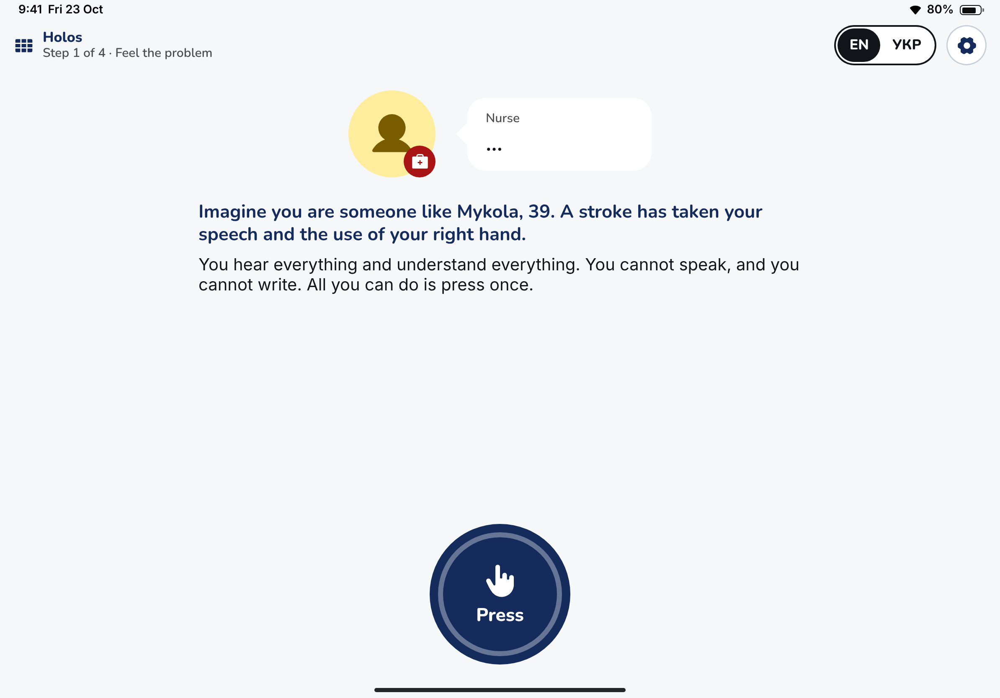</a> | **1 · The problem** (Step 1)<br>The nurse has asked “How are you feeling?”; the first press on the big round switch only knocks dully, and all she gets is “…”. |
| <a href="HolosGrid/02-board-pain.png">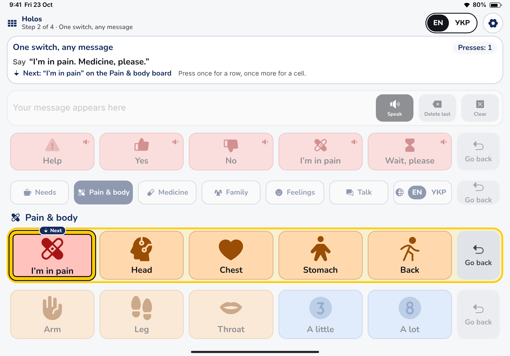</a> | **2 · Row by row** (Step 2)<br>One press has entered the first Pain & body row, so the other rows dim while “I’m in pain” is lit under the navy Next tag. |
| <a href="HolosGrid/03-board-speak.png">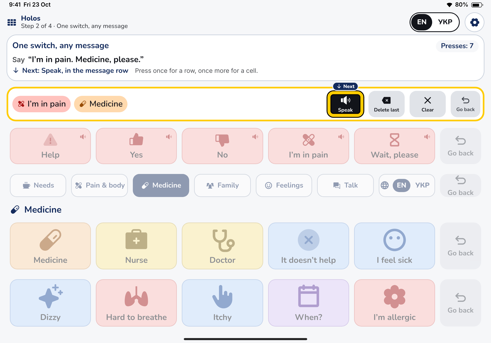</a> | **3 · Then Speak** (Step 2)<br>Seven presses in, “I’m in pain” and “Medicine” are in the message bar, the scan has entered the message row and Speak is lit. |
| <a href="HolosGrid/04-family.png">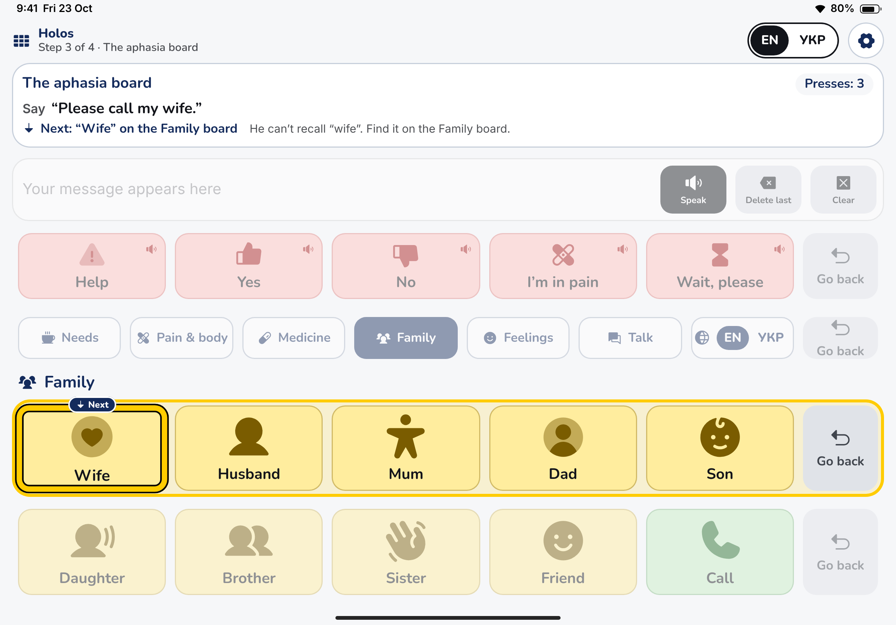</a> | **4 · Recognised, not recalled** (Step 3)<br>Yuriy cannot recall “wife”, so the goal card points to the Family board, where “Wife” — the cell that says “Please call my wife.” — is lit. |
| <a href="HolosGrid/05-head-try.png">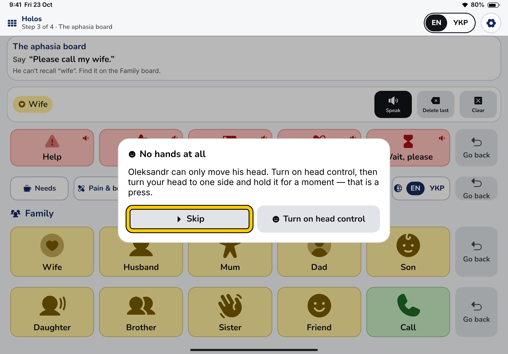</a> | **5 · No hands at all** (Step 3)<br>After the success card, Core’s head-turn panel sits over the stopped board with Skip lit first, so one press moves on. |
| <a href="HolosGrid/06-ukrainian.png">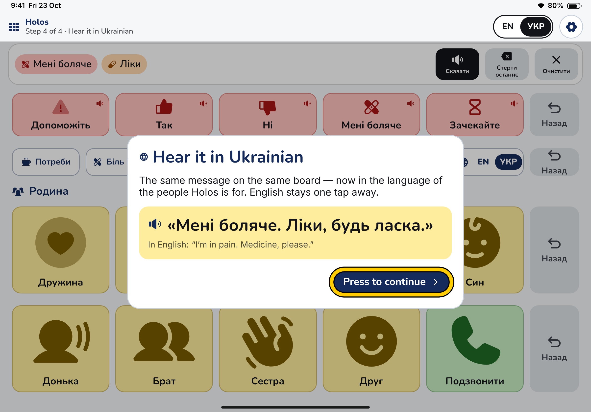</a> | **6 · Hear it in Ukrainian** (Step 4)<br>The board turns Ukrainian and says «Мені боляче. Ліки, будь ласка.», while the card that explains it stays in English. |
| <a href="HolosGrid/07-closing.png">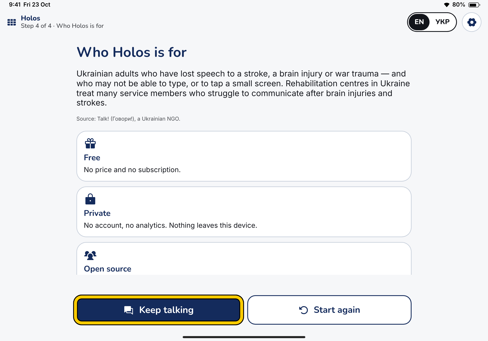</a> | **7 · Who Holos is for** (Closing)<br>After a first press “Keep talking” is lit; on an 11-inch iPad the three pillars stack, so the third runs below the fold. |
| <a href="HolosGrid/08-iphone.png">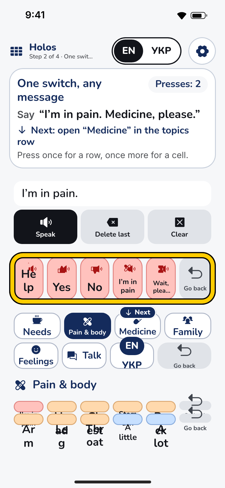</a> | **8 · On an iPhone** (Step 2)<br>On a phone the board adds a large sentence strip (“I’m in pain.”), keeps each row at its minimum size and scrolls; the scan is passing the quick phrases. |

## Holos Bedside

A conversation, not a keyboard. [About this prototype](../Prototypes/HolosBedside.md) · [What the redraw found](FINDINGS.md#holos-bedside)

| Screen | What it shows |
| --- | --- |
| <a href="HolosBedside/01-problem.png">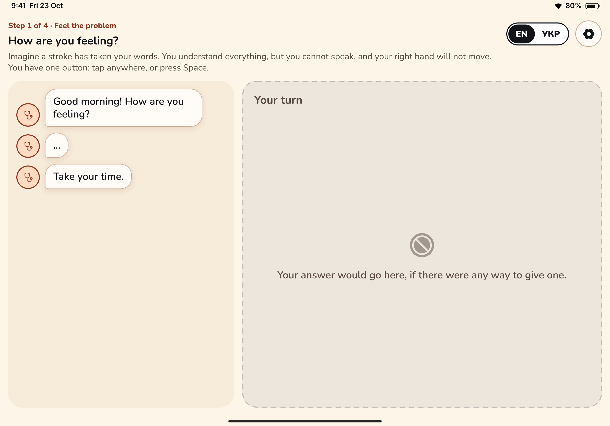</a> | **1 · The problem** (Step 1)<br>The nurse asks how you are feeling and waits ("…", "Take your time."), but where your reply should be there is only an empty grey box: a press finds nothing to choose. |
| <a href="HolosBedside/02-feeling.png">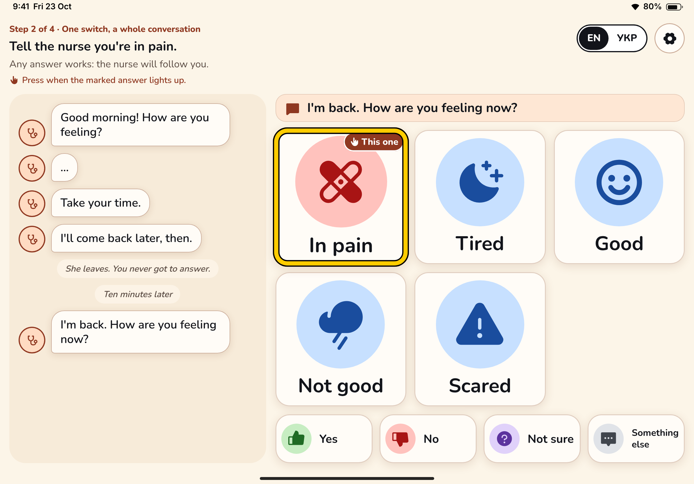</a> | **2 · One switch, a whole conversation** (Step 2)<br>The nurse is back, and the board offers only the five answers that fit her question above the Yes · No · Not sure · Something else strip; the scan has lit In pain, the answer the terracotta "This one" tag marks. |
| <a href="HolosBedside/03-body-map.png">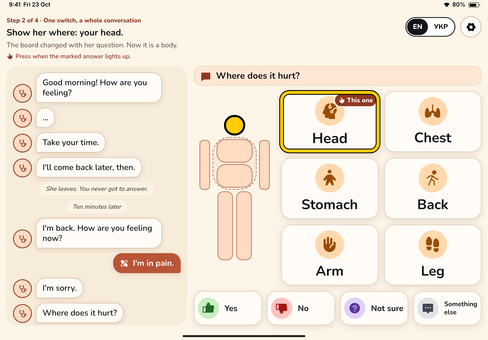</a> | **3 · Where does it hurt?** (Step 2)<br>After "I'm in pain." the board turns into a body, and the scan lights the head on the drawn figure and the labelled Head cell at the same moment. |
| <a href="HolosBedside/04-pain-scale.png">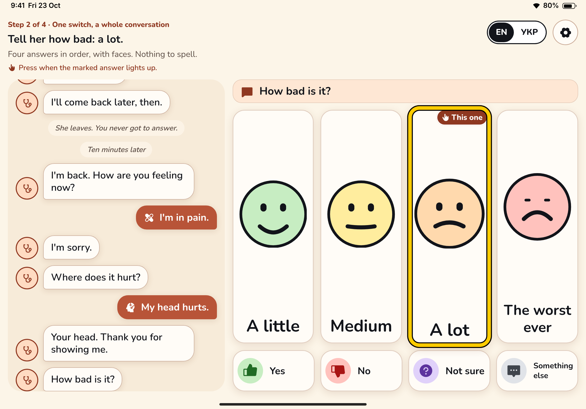</a> | **4 · How bad is it?** (Step 2)<br>The answers become an ordered scale of faces, smile to frown, and the scan has moved on to A lot, the third of the four and the one the guide marks. |
| <a href="HolosBedside/05-something-else.png">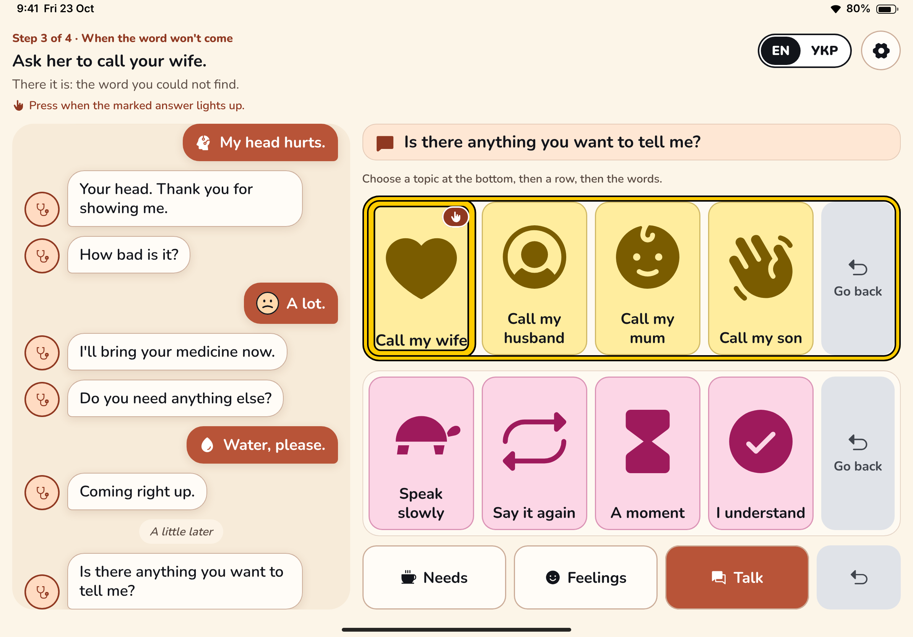</a> | **5 · When the word won't come** (Step 3)<br>The open question has no predicted answer, so the person chose Something else, then the Talk topic, then the top row, and inside the row the scan now lights Call my wife under the guide's tag. |
| <a href="HolosBedside/06-ukrainian.png">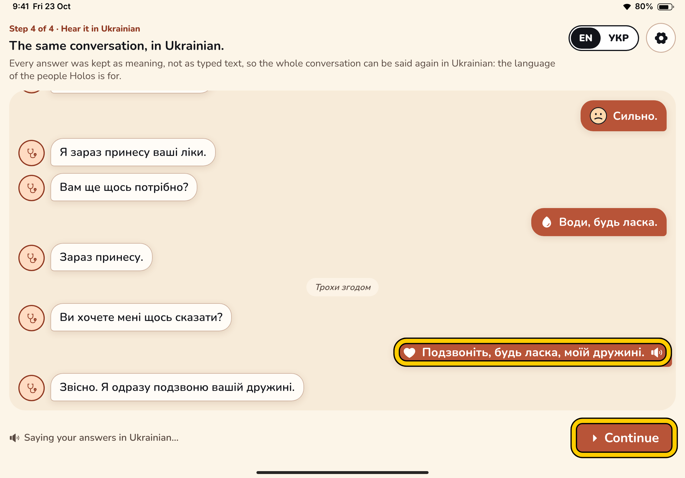</a> | **6 · Hear it in Ukrainian** (Step 4)<br>The whole conversation is redrawn in Ukrainian, nurse and person alike, while the screen around it stays in English, and each answer is spoken again; «Подзвоніть, будь ласка, моїй дружині.» is being said now. |
| <a href="HolosBedside/07-closing.png">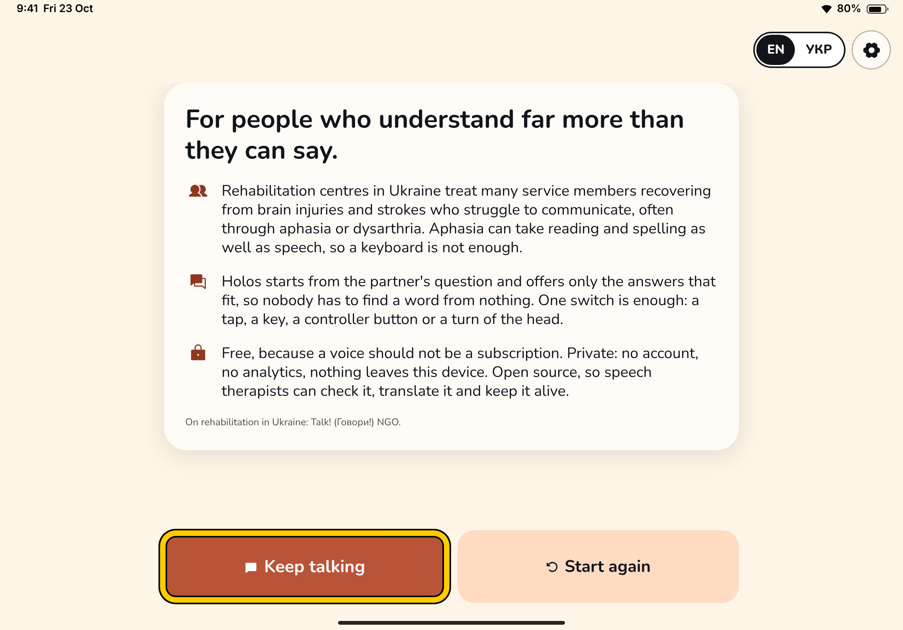</a> | **7 · Who it is for** (Closing)<br>The closing card says who Holos is for and why it is free, private and open source, and the scan has lit Keep talking, which opens the free board a carer drives with question cards. |
| <a href="HolosBedside/08-iphone.png">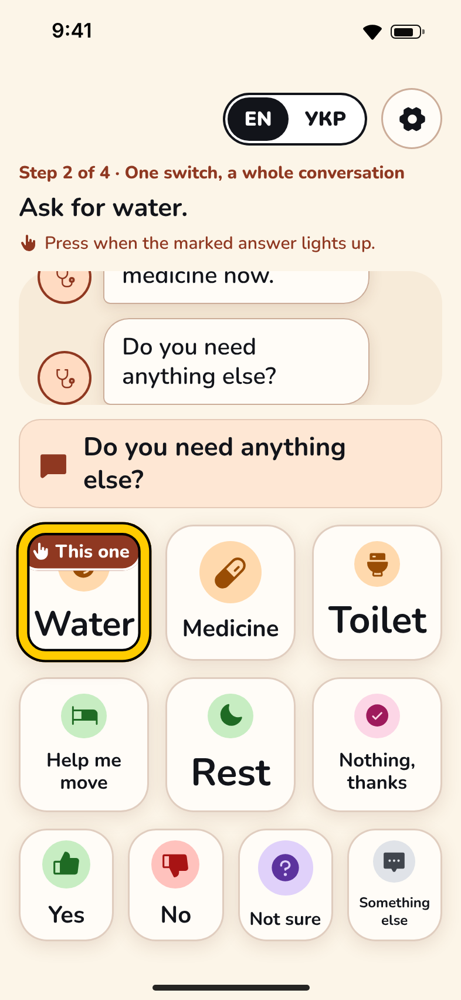</a> | **8 · On iPhone** (Step 2)<br>The same conversation on an iPhone in portrait: the chat shrinks to a fifth of the height above "Do you need anything else?" and its six answers, with Water lit and tagged. |

## Holos Room

Point at the world. [About this prototype](../Prototypes/HolosRoom.md) · [What the redraw found](FINDINGS.md#holos-room)

| Screen | What it shows |
| --- | --- |
| <a href="HolosRoom/01-problem.png">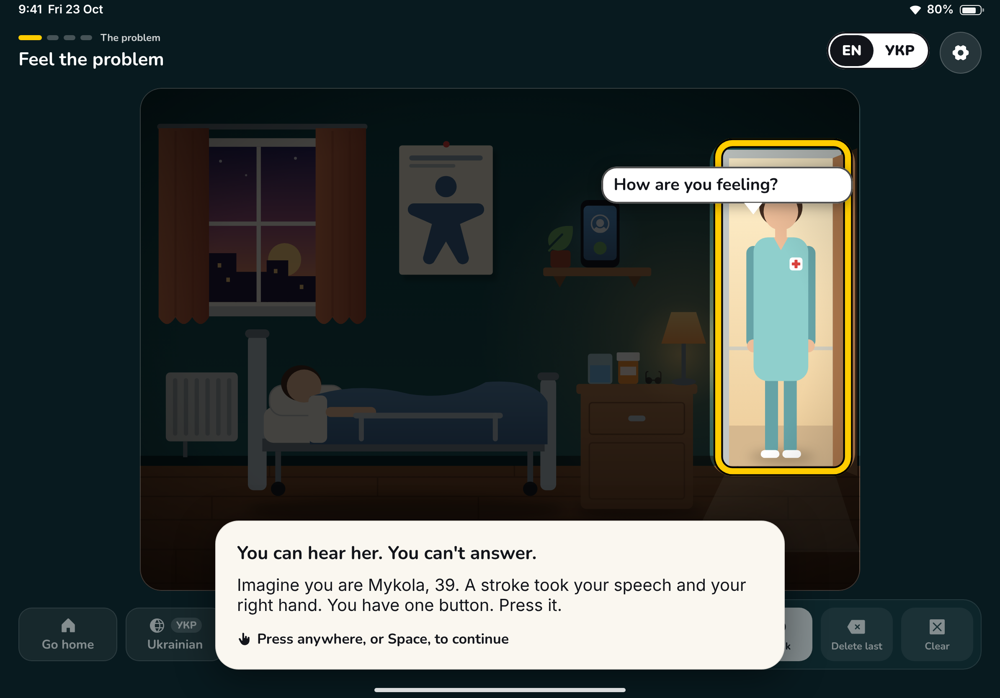</a> | **1 · The problem** (Step 1a)<br>The ward is dark except for the nurse in the doorway, who asks “How are you feeling?”, while the card makes the judge Mykola, with one button and no words. |
| <a href="HolosRoom/02-ward-scan.png">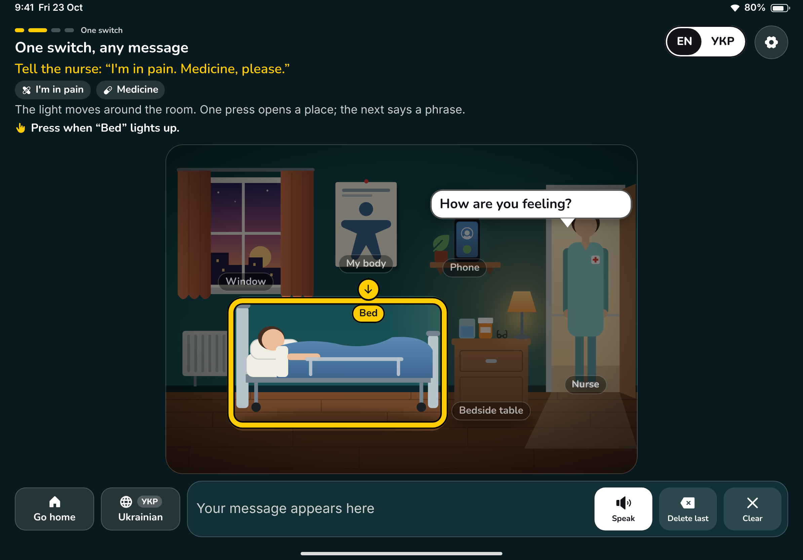</a> | **2 · Scan the room** (Step 2)<br>The lights are up and the scan has reached the bed: the rest of the room dims, the bed gets the yellow ring and pill, and the yellow arrow and the top bar say to press now, under the goal “I'm in pain. Medicine, please.” |
| <a href="HolosRoom/03-bed-ring.png">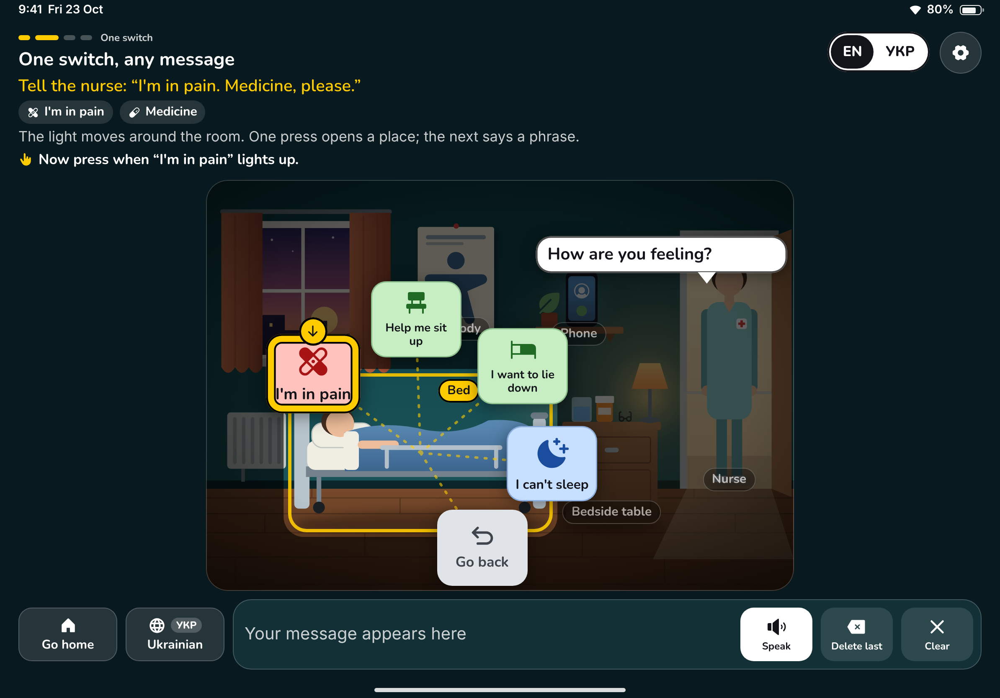</a> | **3 · The bed's phrases** (Step 2)<br>One press opened the bed, so its four phrases and Go back bloom around it on dotted threads, and the scan lights “I'm in pain” first, where the arrow waits. |
| <a href="HolosRoom/04-home-photo.png">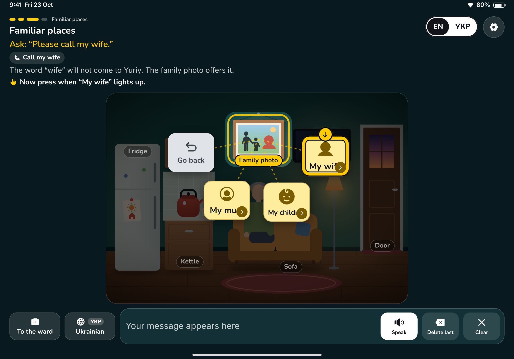</a> | **4 · The photo offers the word** (Step 3b)<br>At home the family photo has opened onto its people rather than its sentences, with “My wife” lit, so Yuriy picks her instead of recalling the word. |
| <a href="HolosRoom/05-ukrainian.png">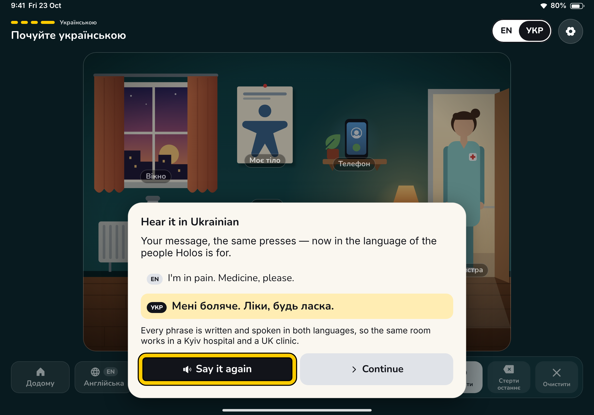</a> | **5 · Hear it in Ukrainian** (Step 4)<br>After the press the whole board behind the card has switched to Ukrainian, while the card stays in English, shows «Мені боляче. Ліки, будь ласка.» as the line now spoken, and lights “Say it again”. |
| <a href="HolosRoom/06-closing.png">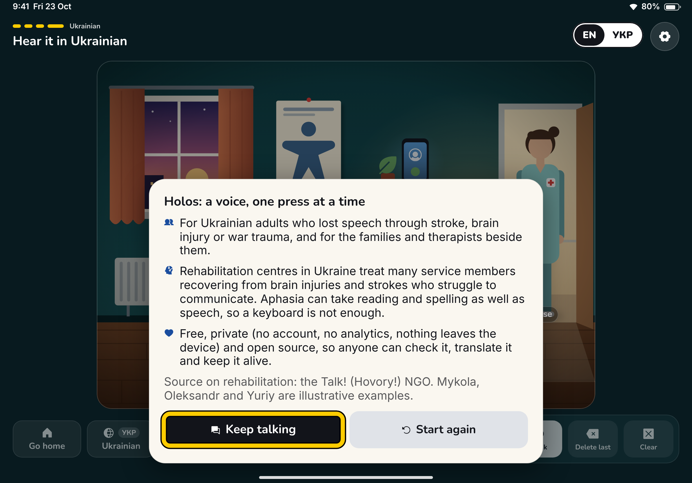</a> | **6 · Closing** (Closing)<br>The closing card says who Holos is for, why a keyboard is not enough and that it is free, private and open source, with “Keep talking” lit first. |
| <a href="HolosRoom/07-iphone.png">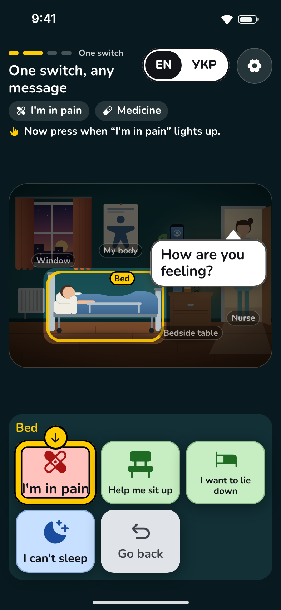</a> | **7 · On an iPhone** (Step 2)<br>On an iPhone in portrait the room shrinks to the screen's width and the bed's phrases leave the picture for a three-column panel of cells, with “I'm in pain” lit. |

## Holos Compass

Four choices, any body. [About this prototype](../Prototypes/HolosCompass.md) · [What the redraw found](FINDINGS.md#holos-compass)

| Screen | What it shows |
| --- | --- |
| <a href="HolosCompass/01-problem.png"></a> | **1 · The problem** (Step 1)<br>The nurse asks “How are you feeling?”, the page introduces Oleksandr, who has only his head and one movement, and that movement is one big lit button whose first press will say nothing. |
| <a href="HolosCompass/02-home.png"></a> | **2 · Four choices** (Step 2)<br>The home level offers Yes, No, I need… and I feel… around the hub; the scan has reached I feel… on the left, which also carries the “Next” tag towards the goal card's first sentence, and the hub's needle points at it. |
| <a href="HolosCompass/03-how-much.png"></a> | **3 · How much?** (Step 2)<br>Three presses in, after I feel › Pain › Head, the hub shows that trail and the yellow draft “My head hurts…”, and the light is on “A lot”, which speaks “My head hurts a lot.” the moment it is chosen. |
| <a href="HolosCompass/04-head-pointing.png"></a> | **4 · Point with your head** (Step 3)<br>With head pointing on and the head tipped up, the Yes petal is lit and its hold ring is filling, the needle points up, and the status line reads “Up — hold to choose” while the panel's own scan sits on Skip. |
| <a href="HolosCompass/05-ukrainian.png"></a> | **5 · Hear it in Ukrainian** (Step 4)<br>One press has switched the whole app to Ukrainian and it is speaking the step-2 message, so the Ukrainian card is ringed in yellow, and «Далі» (Continue) is lit to bring English back. |
| <a href="HolosCompass/06-closing.png"></a> | **6 · Who it is for** (Closing)<br>The closing card says who Holos is for, why aphasia rules out a keyboard, why four choices, that it is free, private and open source, and that an Apple Watch comes next, with “Keep talking” lit. |
| <a href="HolosCompass/07-iphone.png"></a> | **7 · On an iPhone** (Step 2)<br>Step 2 on an iPhone in portrait after the first sentence: the cross shrinks to fit under the goal card, the language and Clear chips move to a full-width row below it, and the light is on “I need…”. |

## Holos Words

Find the word. [About this prototype](../Prototypes/HolosWords.md) · [What the redraw found](FINDINGS.md#holos-words)

| Screen | What it shows |
| --- | --- |
| <a href="HolosWords/01-problem.png"></a> | **1 · The problem** (Step 1)<br>A nurse asks “Who should we call?”, the answer sits blurred inside the blank of “Call my \_\_\_\_”, and in the first five seconds a press gets only a knock and “Nothing. The word won’t come.” |
| <a href="HolosWords/02-starters.png"></a> | **2 · Two choices, one sentence** (Step 2)<br>The scan has entered the starters row and lights “I feel…”, where the Next tag points, while the goal asks for “I feel pain. I need medicine.” and the rows not in play fade. |
| <a href="HolosWords/03-fillers.png"></a> | **3 · Only the words that fit** (Step 2)<br>“I feel…” has opened a blank, “I feel \_\_\_\_”, and the scan has jumped straight to the feelings: the first words row is entered and “Pain” is lit. |
| <a href="HolosWords/04-find-a-word.png"></a> | **4 · Find a word: describe it** (Step 3)<br>“Wife” is not on the board, so after “Call my…” the person describes her: Find a word › A person › Family asks “Which generation?” and “My generation” is lit. |
| <a href="HolosWords/05-candidates.png"></a> | **5 · Find a word: recognise it** (Step 3)<br>Four people to recognise, each with a first-letter cue and the sentence it will say; “Wife” is lit, and choosing it adds “Please call my wife.” to the open blank. |
| <a href="HolosWords/06-ukrainian.png"></a> | **6 · Hear it in Ukrainian** (Step 4)<br>The person’s three sentences replay in Ukrainian, each card showing starter + word above the stored sentence, with Continue lit; the page scrolls on this iPad, so the third sentence, «Подзвоніть, будь ласка, моїй дружині.», starts just below the fold. |
| <a href="HolosWords/07-closing.png"></a> | **7 · A voice that offers the word** (Closing)<br>Who Holos is for and why it is free, private and open source, with “Keep talking” lit to open the board for free use. |
| <a href="HolosWords/08-iphone.png"></a> | **8 · The board on iPhone** (Step 2)<br>The same board on an iPhone in portrait, mid-scan: “I feel pain.” is built, “I need \_\_\_\_” waits, and “Medicine” is lit in a row of small cells whose labels shrink, or truncate, to fit. |

## Settings, shared by all five

The sheet every prototype opens from its gear button, drawn over a board.

| Screen | What it shows |
| --- | --- |
| <a href="shared/01-settings.png">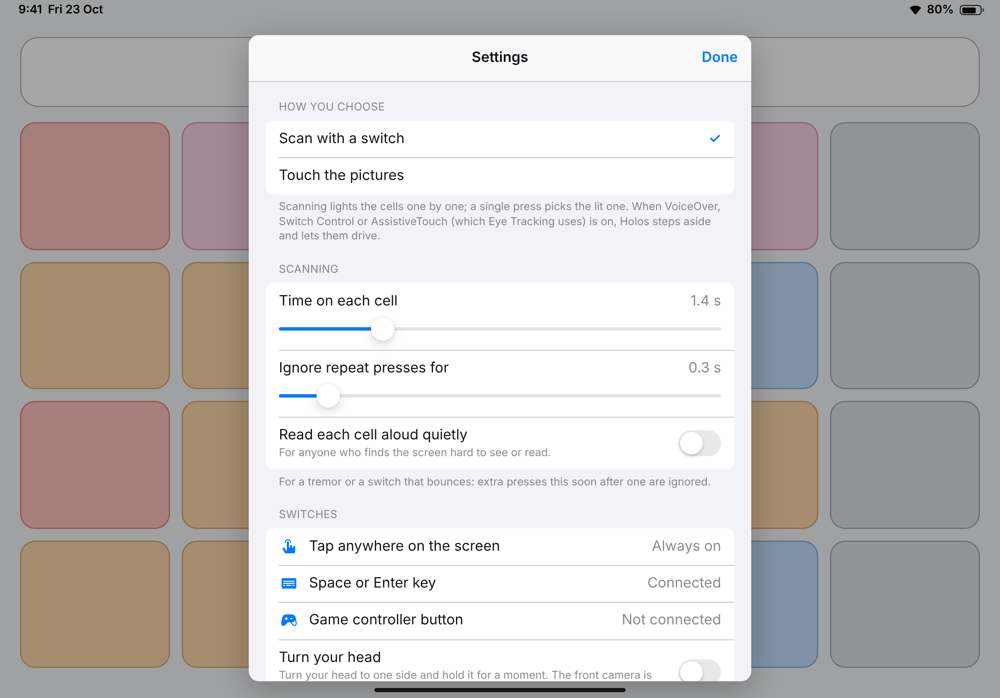</a> | **1 · Settings**<br>The Settings sheet over a board: scanning or touch, time on each cell, ignoring repeat presses, read-aloud, and the switches with their live status. |
| <a href="shared/02-settings-ukrainian.png">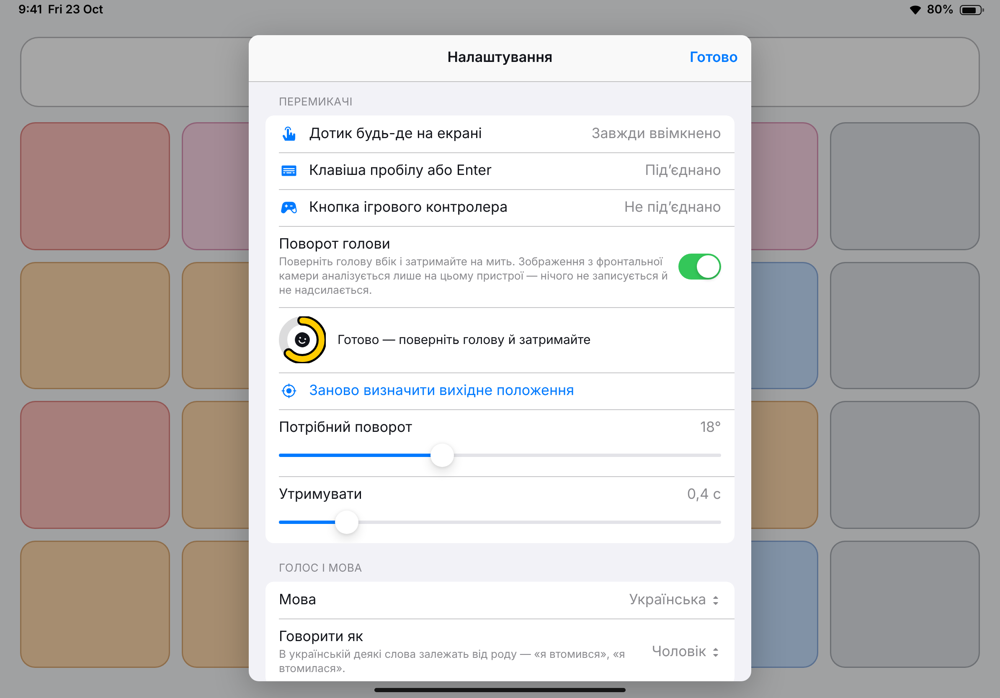</a> | **2 · Settings in Ukrainian**<br>The same sheet in Ukrainian, scrolled to head control switched on — the live meter filling as a turn builds — and the voice and language choices, including speaking as a man or a woman. |

## Making or changing a mockup

Each folder holds one HTML page per screen (`NN-slug.html`), the PNG rendered from it, a
`screens.json` with each screen's title, step and caption, and the folder's own CSS and layout
scripts. After changing a page, render it again:

```sh
node design/kit/render.cjs design/HolosGrid/*.html
```

This needs Node and Playwright's Chromium. [kit/README.md](kit/README.md) explains how a page is
put together and which kit class stands for which Core view. The mockups do not follow the Swift
by themselves: when a prototype's layout or copy changes, update its pages, render them, and keep
`screens.json` in step.
